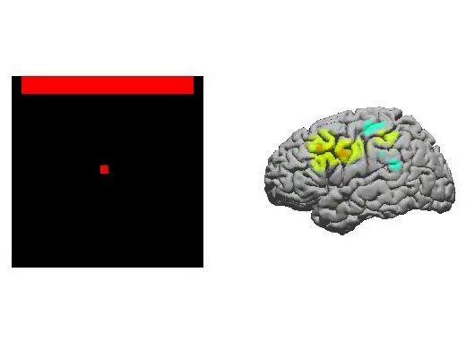

# g.tec and the open neurotechnology tools: works with, and how it started

g.tec amplifiers stream into the open tools that BCI and EEG labs use every day: BCI2000, FieldTrip, OpenViBE, EEGLAB, MNE-Python, Lab Streaming Layer (LSL), UDP, MATLAB/Simulink and Python (g.Pype). Recordings can be stored as EDF, GDF and BIDS. Many of these links go back to the start of each project. g.tec built the first biosignal APIs in the late 1990s, and the g.USBamp was the first amplifier implemented in BCI2000.

## Works with

| Tool or format | g.tec support | How |
|---|---|---|
| Lab Streaming Layer (LSL) | All g.tec amplifiers stream LSL. g.Recorder, cortiQ and g.HIsys Professional can also read LSL streams from other devices. | g.NEEDaccess, [g.Pype](https://github.com/gtec-neurotechnology/gpype), Unicorn Suite and Unicorn Recorder (you choose the protocol) |
| UDP | Supported for many years; faster and more flexible than LSL for many setups | g.NEEDaccess, g.Pype, Unicorn Recorder |
| BCI2000 | g.USBamp was the first amplifier implemented in BCI2000, built on g.tec's API | BCI2000 source modules for g.tec amplifiers |
| FieldTrip | Co-developed with Robert Oostenveld; a realtime acquisition module for g.tec amplifiers based on g.NEEDaccess was added in 2017 ([FieldTrip bug 3273](https://bugzilla.fieldtriptoolbox.org/bug/3273)) | FieldTrip realtime buffer |
| OpenViBE | Co-developed with the INRIA OpenViBE team; a g.USBamp acquisition driver has been in the OpenViBE acquisition server since its October 2009 release ([report](https://psychophysiology.blogspot.com/2009/10/l-open-vibe-40-est-arrive.html)) | OpenViBE acquisition server |
| EEGLAB | Reads g.tec data formats, and has since EEGLAB started | EEGLAB file import |
| MNE-Python | Through LSL, EDF/GDF/BDF files or g.Pype | MNE-LSL, file import |
| MATLAB and Simulink | g.tec's original API, partnership with MathWorks since 2000 | g.HIsys, g.NEEDaccess MATLAB API |
| Python | Python SDK for real-time pipelines, `pip install gpype` | [g.Pype](https://gpype.gtec.at) |
| Unity, Meta Quest | Unicorn band-power and c-VEP plugins | [showcase](../showcases/vr-xr-for-390-euro/README.md) |
| EDF, GDF, BDF | g.tec helped develop EDF and GDF with Alois Schlögl at TU Graz, starting in 1998 | g.tec software; Unicorn Recorder writes BDF |
| BIDS | All g.tec data formats can be stored as BIDS, for every amplifier, since BIDS began | g.tec software |

## How it started

| Year | What happened | Source |
|---|---|---|
| 1997 | Christoph Guger and Günter Edlinger write a MATLAB interface that streams EEG sample by sample, which g.tec calls the first biosignal API | [g.tec article](../articles/2026-06-10_how-gtec-helped-create-the-open-neurotechnology-ecosystem-and-api.md) |
| 1998 | Work on GDF starts at TU Graz as an extension of EDF, with the later g.tec founders involved | [GDF technical report](https://pub.ista.ac.at/~schloegl/matlab/eeg/gdf4/TR_GDF.pdf), [Schlögl 2006, arXiv cs/0608052](https://arxiv.org/abs/cs/0608052) |
| 1999 | g.tec is founded and shows one of the first portable BCI systems at the first international BCI meeting in Rensselaerville, New York | [g.tec article](../articles/2021-08-27_history-of-bci-first-bci-system.md) |
| 2000 | Development partnership with MathWorks; standard APIs for MATLAB, Simulink and C | [g.tec article](../articles/2026-06-10_how-gtec-helped-create-the-open-neurotechnology-ecosystem-and-api.md) |
| 2004 | BCI2000 is published. g.USBamp is its first implemented amplifier, through g.tec's API | [Schalk et al. 2004, doi:10.1109/TBME.2004.827072](https://doi.org/10.1109/TBME.2004.827072) |
| 2004 | The first ECoG-based BCI in humans (St. Louis, recorded with g.USBamp and BCI2000): four patients control a cursor after 3 to 24 minutes of training, with 74–100% success | [Leuthardt, Schalk, Wolpaw, Ojemann & Moran 2004, doi:10.1088/1741-2560/1/2/001](https://doi.org/10.1088/1741-2560/1/2/001) |
| 2004 | EEGLAB is published and reads g.tec formats | [Delorme & Makeig 2004, doi:10.1016/j.jneumeth.2003.10.009](https://doi.org/10.1016/j.jneumeth.2003.10.009) |
| 2009 | OpenViBE ships a g.USBamp acquisition driver | [report](https://psychophysiology.blogspot.com/2009/10/l-open-vibe-40-est-arrive.html), [Renard et al. 2010, doi:10.1162/pres.19.1.35](https://doi.org/10.1162/pres.19.1.35) |
| 2011 | FieldTrip is published | [Oostenveld et al. 2011, doi:10.1155/2011/156869](https://doi.org/10.1155/2011/156869) |
| 2017 | FieldTrip adds a realtime module for g.tec amplifiers based on g.NEEDaccess | [FieldTrip bug 3273](https://bugzilla.fieldtriptoolbox.org/bug/3273) |

## The first ECoG BCI, on video

ECoG-based cursor control with g.USBamp and BCI2000 (3 minutes). Left: the BCI2000 cursor task, where the cursor moves to the target bar. Right: the ECoG activity on the patient's cortex while they control it. Video: [media/ecog-gusbamp-bci2000.mp4](media/ecog-gusbamp-bci2000.mp4).

The study by Leuthardt, Schalk and colleagues (2004) showed that signals recorded from the brain surface allow fast cursor control: patients learned it within minutes. EEG-based BCIs needed far longer training.

## Notes

- Statements on co-development, "first amplifier in BCI2000", EDF/GDF involvement, EEGLAB and BIDS support come from g.tec (Christoph Guger, 2026). The table links to independent sources where they exist.
- Questions about connecting a g.tec device to a specific tool: [guger@gtec.at](mailto:guger@gtec.at).
